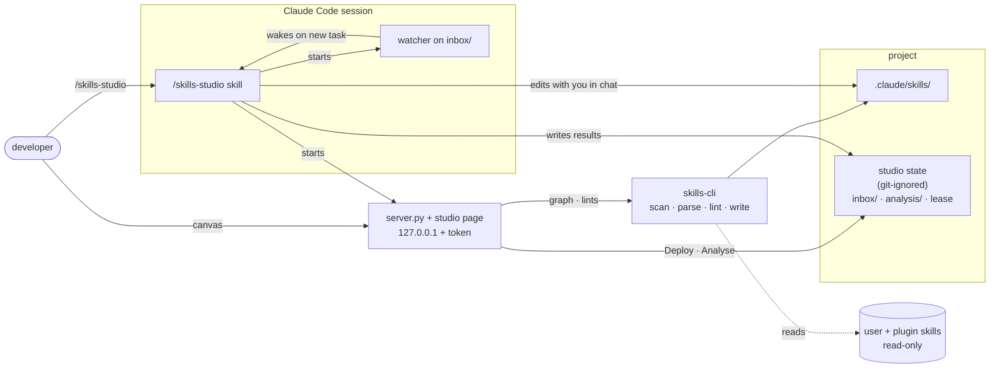

# Skills Studio — design

A visual workspace for a project's Claude skills, in the style of Node-RED: skills are nodes, the
calls between them are wires. Its purpose is to keep skills small and focused — to split large skills
into building blocks, merge overlapping ones, and link small ones into workflows — without changing
how a composed skill behaves.

Status: design, hardened by a grilling session on 2026-11-02. Nothing is built.

## Goals

- See which skills a project has and how they call each other.
- Review, edit and create the project's skills.
- Get suggestions for splitting, merging and tightening skills, and carry them out with Claude.
- Keep a composed skill's behaviour unchanged when a part of it is extracted.
- Let an extracted skill also be used on its own: that is a goal, not a side effect.

## Non-goals (v1)

- Writing outside the project. User skills (`~/.claude/skills`, which point into the Brain vault) and
  plugin skills are never written.
- An automated behaviour-test harness (scripted gate answers, sandbox repo, stubbed tracker and wiki,
  N runs per version). Verification in v1 is manual; the harness may become its own project.
- Rendering in the terminal. The studio is started from the CLI and works in a browser.
- Hiding extracted skills from triggering on their own.

## Architecture

The same shape as the software factory: a skill drives the Claude session, a standard-library Python
CLI does everything mechanical and prints JSON, a local server serves the page, and all state lives
on disk.

- **Started from a Claude session** with `/skills-studio`. The project is the session's working
  directory. The skill starts the server, opens the page and starts a watcher on `inbox/`.
- **The canvas never asks a model itself.** Deploy and Analyse write a task to `inbox/`; the watcher
  wakes the session at once, and the work happens in the chat, where the developer sees and steers it.
- **One studio per project.** A lease, as in the factory's orchestrator, keeps two sessions from
  running the same task; a second `/skills-studio` names the session that holds it.
- **State on disk.** Tasks, analysis results and the lease live in a git-ignored folder in the
  project, so a restart resumes from what the folders say.

## Scope

| Source | Shown | Writable | Linkable |
|---|---|---|---|
| Project (`.claude/skills/`) | yes | yes | yes |
| User (`~/.claude/skills/`) | in the palette, read-only | no | no |
| Plugin | in the palette, behind a filter, read-only | no | no |

A user or plugin skill can be **copied into the project as a template**. The copy:

- must take a new name, so both exist side by side and nothing is shadowed;
- records its origin in `metadata.copied_from`, so the studio can show that the source has changed
  since the copy was taken (it never syncs automatically);
- is checked for personal content (paths into `~/Brain`, vault pointers, wording addressed to one
  person), since it lands in a repository the team shares.

## Link model

**The skill's text is the only source of truth.** Nothing about links is stored in frontmatter or in
studio state: what a parent runs is what its body says, so a second record would only drift from it.

- A **wire** A → B is drawn wherever A's body names B **by the name Claude knows it by**. Every
  such mention counts, including awkward ones ("unlike `brain-code-review`…"); a surprising wire is
  a prompt to fix the text, not something to hide. What counts as naming B:
  - a plugin skill: its qualified name, `atlassian:triage-issue`; a synced skill:
    `anthropic-skills:docs`. "Write some docs" is just words. Skills of one plugin may also name
    each other by their bare name;
  - a project or user skill: its name as a whole word (`brain-grill-me`); a one-word name
    (`commit`, `tdd`) only in backticks or as `/commit`, since as a plain word it is just a word.
- A wire to a name that is not in scope is **broken** (red).
- A wire is a **call** or a **mention**. A call: following A makes Claude run B, as a step, a
  preflight or a handoff. A mention: anything else — a *Related* link, a "don't run it here", a
  pointer for the developer. That is a judgement, so Claude makes it in Analyse; the studio keeps it
  per skill with a fingerprint of the text (`.skills-studio/wire-kinds.json`), and a skill whose text
  changed is judged again. A wire not judged yet counts as a call.
- **Order and conditions** live in the parent's text. The studio does not model them; it orders
  wires by the position of the first mention.
- **Adding a call** from the skill dialog creates a link task ("let `close-feature` call
  `git-finish`"); Claude decides where in the parent's text it belongs.

## Views

- **Cards** — each project skill that nothing calls is a card; the skills it calls sit inside it as
  cards of their own, in call order, and what it only mentions is listed at its foot. A skill called
  from several places is shown in full once and collapsed elsewhere; a loop is marked, not followed.
  Each card shows the description's first sentence, how often the skill is used (`/skill-doctor`) and
  its worst finding; a never-used skill is faded. Palette on the side: project, user, synced and
  plugin skills.
- **Skill** (a dialog, opened from a card or the palette) — one page in two parts: *every turn*
  (the frontmatter, with its cost and the description's length against the limit) and *when it runs*
  (the body, rendered as markdown, with every skill it names marked as a call, a mention or missing).
  *Edit* turns the same page into fields — name, description, the body as markdown — saved as one
  task the session writes as typed. Changing it with Claude, improving with skill-creator, adding a
  call and deleting sit at the foot, each a task.
- **New skill** — a short form (name, description, intent), then handed to the session to write with
  skill-creator.
- **Analysis** — the latest suggestions from Analyse, each one a Deploy task the developer can send.

## Analyse

Run on demand only, over all of the project's skills at once (merges need the whole set). It suggests:

- **Splits** — parts of a skill that are a skill of their own, also when the part is spread across
  sections (the git handling in a close-feature skill sits in four steps and the guardrails).
- **Merges** — skills that overlap; merge them, or let one call the other.
- **Tightening** — a vaguer or longer description than needed, triggers that collide, a body longer
  than its job.
- **Reuse** — a project skill that resembles a read-only user or plugin skill, with the suggestion to
  copy that one as a template.

## Local checks

Always on, no model, from `skills-cli`:

- missing or broken frontmatter; missing `name` or `description`
- broken wires (a referenced name not in scope)
- duplicate names across sources
- description too long or too short
- trigger overlap by word similarity (a coarse flag; Analyse gives the real judgement)
- personal content in a copied skill
- ≈tokens per skill, for the listing (name + description) and for the body, estimated as characters/4
  — the studio runs outside the session and cannot read the engine's own counts

## Keeping behaviour when splitting

"Behaves the same" means: when the parent is used, it **stops and asks at the same gates** and reaches
the **same end state** (for a close-feature skill: merged, branch removed, tracker moved). Extracting a
part is not a change in behaviour; the extracted skill is a new building block.

In v1 this is checked by hand: the studio shows the parent before and after side by side, and the
developer runs it.

## Open questions

- **Re-arming the watcher.** Spike 2026-11-02: a `Monitor` polling `inbox/` once a second woke an
  idle session about a second after a detached process dropped a task, and the session read it.
  Limits found: a monitor expires after at most 30 minutes and each expiry also wakes the session,
  so the skill must re-arm it; and the watch does not survive a session restart, so
  `/skills-studio` must re-arm it and pick up tasks already waiting in `inbox/`. Poll with `ls`, not
  a bare glob: zsh aborts on a glob with no match. Still open: whether a mod (`$.prompt.submit` on a
  timer) is a quieter watcher than `Monitor`.
- **No canvas library.** The first build drew nodes and wires with Drawflow; the wires turned out
  harder to read than nesting, so the cards are plain HTML and the page loads nothing from outside.
